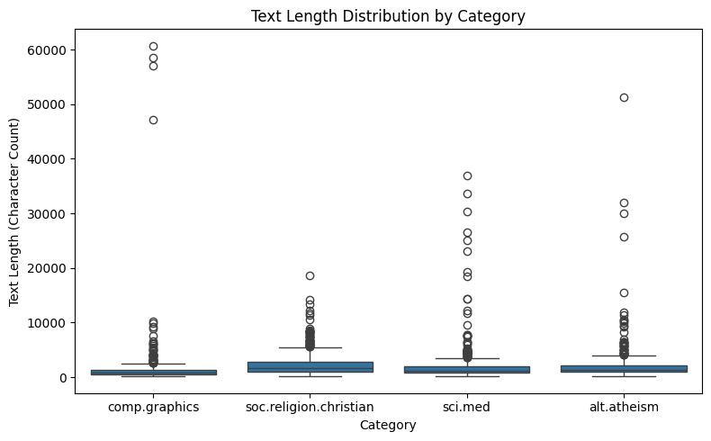
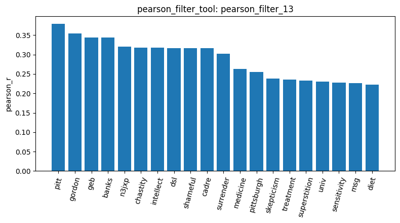
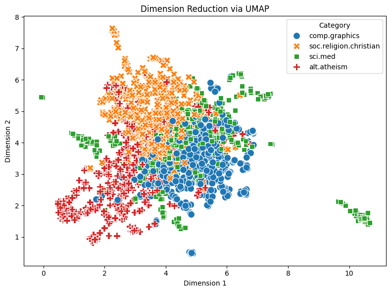

# Agentic Pipeline Report: 20 Newsgroups

I ran my own tools on 2,257 posts from 4 categories: christian 599, sci.med 594, graphics 584 and atheism 480 (`load_dataset_1`). My kernel crashed halfway, so result IDs restart in the second session; I mark them [S1] and [S2]. The data was clean, with no missing text and no duplicates (`check_missing_3`, `check_duplicates_4` [S1]). Post length was very uneven, though: `describe_data_5` [S1] shows 4 graphics posts longer than about 47,000 characters, and the longest has 60,713. I built the document-term matrix with English stop words removed and tested `min_df` 5 vs 6. Going to 6 dropped 14% of the words (8,322 → 7,151) but only 2.7% of the non-zero cells (`dtm_6` vs `dtm_7` [S1]), so most of the vocabulary is rare words. I kept 6. The matrix is 98.70% zeros, and rebuilding it in session 2 gave exactly the same result (`dtm_5` [S2]).

Counting the most frequent words mostly found email header junk. In `term_freq_8` [S1], 9 of the top 20 words come from headers (`edu` 4,675, `subject`, `lines`, `organization`…), and only `god` and `jesus` are real topic words. The variance filter kept 757 words at threshold 0.1 and 4,162 at 0.01 (`variance_filter_10`, `_11` [S1]). But variance doesn't look at the categories at all, so it can't tell a topic word like `jpeg` from junk like `edu`. Pearson correlation with a category worked better, but it also picked up junk. For graphics, the top word is `thanks` (r ≈ 0.28), followed by "asking for help" words (`looking`, `hi`, `advance`) and header fields (`nntp`, `host`) (`pearson_filter_12` [S1]). For sci.med, the top 11 words (`pitt` r ≈ 0.38, `gordon`, `banks`, `geb`, `chastity`, `intellect`…) are all from **one person's email signature**, and they rank above real medical words like `medicine` (≈ 0.26) (`pearson_filter_13` [S1]). Spearman cares more about *whether* a word appears than how many times, so it pushed `disease`, `doctor` and `patients` into the top 20. The signature still stayed on top (`spearman_filter_14` [S1]).

Looking at how words move together, the graphics words are almost duplicates of each other (`jpeg`–`gif` 0.96, `image`–`images` 0.89), while religion words are much looser (`god`–`jesus` only 0.23) (`feature_corr_15` [S1]). For pattern mining on graphics, the default `min_sup = 1` crashed my kernel: with a support that low, almost every combination of words counts as a pattern. After the restart, top-k with k = 20 only returned header patterns, with `lines` and `subject` in all 584 posts (`mine_patterns_2` [S2]). FP-Growth with `min_sup = 60` found 2,107 patterns, but many are just a word glued to `lines` or `subject` (`mine_patterns_3` [S2]). Both methods work on the same list of patterns; top-k keeps the top 20, while FP-Growth keeps everything above 60. The real words that showed up (`advance`, `problem`) again point to graphics being mostly a help forum.

Dimension reduction showed the topics best. PCA (16.42% + 7.44% of the variance, `reduce_dimensions_6` [S2]) put almost every post in one big overlapping blob, with 4 graphics posts far away. These are most likely the 4 huge posts from `describe_data_5`, so PCA on raw counts is mostly showing outliers, not topics. t-SNE (`reduce_dimensions_7` [S2]) split religion from tech posts. UMAP (`reduce_dimensions_8` [S2]) also separated atheism from christian and gave graphics its own area. sci.med stayed scattered inside the graphics area and in a few small islands, which makes sense since it never had strong words of its own.

Finally, cosine similarity on raw counts barely told categories apart [S2]: two sci.med posts (rows 561 and 1513) scored 0.0813, and a sci.med vs christian pair (rows 561 and 440) scored 0.0719. Both are close to 0, meaning the posts share very few words, and the gap between them is only 0.0094, so same-category posts are practically no more similar than cross-category ones.

## Conclusion

The 4 topics can be told apart, but no single word does it well. The strongest correlation I found was r ≈ 0.38, and even that came from a signature. The topics only become clearly visible when all words are used together, as in t-SNE and especially UMAP, where religion vs tech, and even atheism vs christian, separate. On the way there, almost every simple method got distracted first by things that aren't topics. Email headers dominated term frequency and pattern mining (`term_freq_8`, `mine_patterns_2`). One author's signature topped the sci.med correlations (`pearson_filter_13`). Four huge graphics posts drove PCA (`reduce_dimensions_6`). So the main lesson is to look at what a tool actually picked up before trusting it: a high score on raw text can just as easily come from formatting, one prolific user or one long post as from the topic itself. sci.med was the hardest category throughout. It had no strong words of its own and stayed scattered in UMAP.
