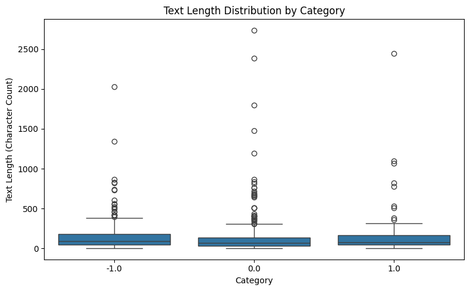
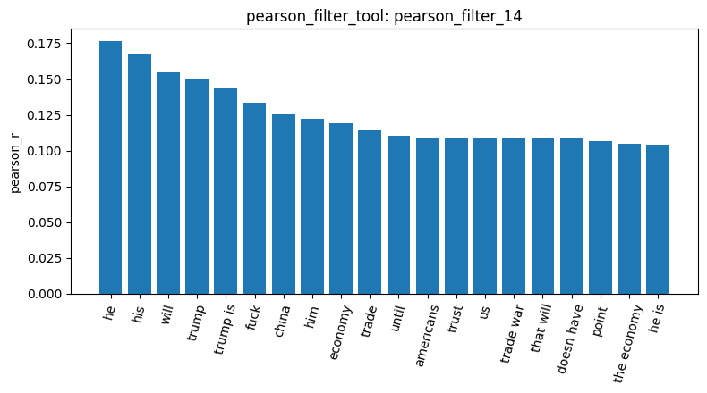
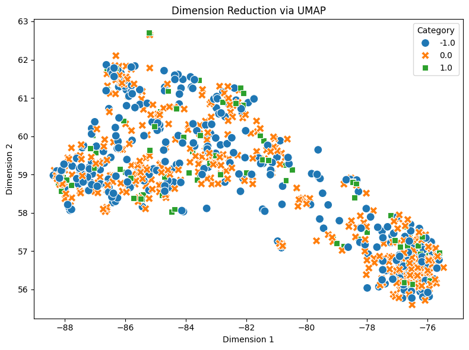

# Homework Report: Reddit Stock Sentiment

I ran the same tools from the pipeline on 847 Reddit posts about stocks: neutral `0.0` (423), negative `-1.0` (315) and positive `1.0` (109) (`load_dataset_1`). The goal was to find patterns in the text for each sentiment. Some numbers below come from checks I ran myself on the CSV, outside the agent chat. I mark those *(own check)*. No text was missing (`check_missing_3`), but there were 23 duplicates (`check_duplicates_4`). Most of them are daily bot posts from one website ("Gappers for today", "Updated Daily by EOD"), all labeled neutral *(own check)*. Dropping them with `keep=False` removes every copy, so 34 rows went, not 23. That leaves 813 posts: 391 neutral, 315 negative, 107 positive (`check_duplicates_6`). The posts are really short. The median is 78 characters, about 16x shorter than 20 Newsgroups. Negative posts are a bit longer (median 96, vs 68 neutral and 77 positive), but the boxes overlap almost completely. So length alone can't tell the sentiments apart (`describe_data_7`).

The biggest decision was how to build the document-term matrix. English stop words remove "not" and "didn't", and those flip the meaning: "He didn't say thank you" basically becomes "say thank". So I kept all words and added word pairs (`ngram_range=[1, 2]`), so things like "not good" stay in. Going from `min_df` 2 to 3 cut the vocabulary almost in half (3,346 → 1,727 terms) but only 16.5% of the non-zero cells (`dtm_8` vs `dtm_9`). That's a much bigger cost than in the pipeline (2.7%), because each post only has about 20 terms. I still went with 3, because a word that shows up in just 2 posts can pass a 0.1 correlation by pure luck. The matrix is 98.84% zeros, and 28 posts end up with no terms at all *(own check)*. The variance filter didn't work here. At 0.01 it kept 519 terms but threw out `stupid`, `dumb`, `falling` and `don think`. At 0.125 it kept 40 terms, all filler like `the`, `to`, `and` (`variance_filter_10`, `_11`). Sentiment words are rare, so their variance is low, and the filter keeps exactly the wrong words. The heatmap of those filler words (`feature_corr_18`) mostly just shows post length: they all go up together in long posts (`will`–`be` 0.59). The only odd one is `he`, which barely correlates with anything.

Pearson correlation gave a different picture for each class. **Positive** is weak: only 23 terms pass 0.1, and the best one is r = 0.156 (`pearson_filter_13`). The top words `tldr`, `main` and `huge` each show up in only 3 posts, all positive. A lot of the others sound like stock pitches (`technology`, `potential`, `electric`, `green`, `solutions`). And `good` is in 40 posts, but 12 positive, 13 negative and 15 neutral, so it's not really a positive word here *(own check)*. **Negative** is stronger and backed by way more posts: `he` (r = 0.176), `trump`, `china`, `trade war`, `economy` (`pearson_filter_14`). `he` alone is in 86 posts, 57 of them negative *(own check)*. So negative posts are mostly people angry about Trump and the tariffs. The pair `doesn have` shows up in 6 posts, all negative, so keeping stop words and adding pairs did pay off. **Neutral** has no words of its own. Only `year` and `always` reach r = 0.10. The other "kept" terms (`trump`, `he`, `economy`, `trade`) are actually negative correlations, hidden at the bottom of the sorted list (`pearson_filter_25`). So neutral is basically what's left when there's no politics or emotion in the post.

Pattern mining on the negative posts shows the same topic, and also how rarely words show up together in such short posts. Top-k with k = 20 only gave single words: `trump` 45, `china` 33, `tariffs` 16, `fuck` 14, `good` 13 (`mine_patterns_15`). FP-Growth with `min_sup = 8` found 58 patterns (`mine_patterns_16`), but only 6 are pairs, and all of them involve Trump, like {china, trump} 9 and {trump, xi} 8 *(own check)*. For comparison, 20 Newsgroups gave 2,107 patterns at `min_sup = 60`. When I switched to `filtering_method="term_frequency"`, which drops the 5% most common words, real frustration words showed up: `dump`, `lose`, `wrong`, `stupid`, `lol` (`mine_patterns_17`). So the filter you pick really changes what you find.

Dimension reduction didn't show any sentiment groups. In PCA (27.99% + 5.02%, `reduce_dimensions_19`), the two outliers are just the longest neutral post (2,737 chars) and the longest negative post (2,028), and PC1 correlates 0.92 with post length *(own check)*. Same as in the pipeline, PCA on raw counts is mostly measuring length. UMAP (`reduce_dimensions_20`) shows two regions, but they split short posts (median 41 chars) from longer ones (median 120), with almost the same sentiment mix in both *(own check)*. t-SNE (`reduce_dimensions_21`) is one big mixed cloud. Cosine similarity explains why. "this stock is going up" vs "this stock is not going up" scores 0.80 (`cosine_similarity_23`), while "buy the dip" vs "sell everything now" scores 0.0 (`cosine_similarity_22`). Bag-of-words only counts shared words, not meaning. With English stop words the first pair would even score 1.0, identical *(own check)*. So keeping negations helped, but not much.

## Conclusion

My tools worked on the new dataset without changes, but I only found a weak sentiment signal. The clearest patterns weren't about sentiment at all: post length (which drives both PCA and UMAP), duplicated bot posts, and the Trump/trade-war topic. Each class looks different. Negative is the easiest to spot, mostly through politics and a few negation pairs. Positive rests on a handful of rare words. Neutral has no words of its own and is defined by what's missing. In 20 Newsgroups the topics separated easily because each topic has its own vocabulary. Here all three sentiments talk about the same thing (stocks) with mostly the same words, so word counts can barely tell them apart. The main lesson is: look at what a tool actually picked up before trusting it. Here, the top "positive" words were backed by only 3 posts each, `good` turned out to be just as common in negative posts, and the words that looked "neutral" were actually negative correlations. Two caveats. Positive only has 107 posts, so many of its correlations rest on very few examples. And the labels might be noisy: "Seeing lots of red in the ticker" is labeled neutral, and the label only matches the sign of the CSV's own `polarity` score 46% of the time *(own check)*.
